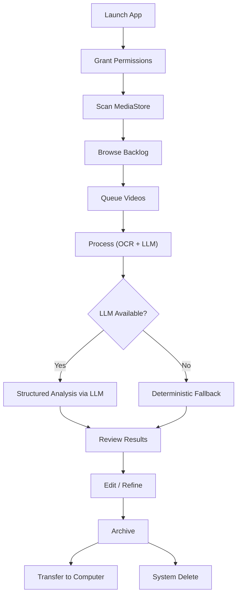

# Video Knowledge Sorter — Adversarial Battle-Test Analysis

**Date**: 02 Jul 2026  
**Workspace**: `c:\Users\anujd\Documents\01_AI\267_android_media_learn`  
**Anti-Bias Protocol Applied**: ST1–ST6 broadest-scope stress tests, no assumptions of missing behaviour.

---

## 1. Purpose and Use-Case Summary

**App Name**: Video Knowledge Sorter  
**Platform**: Android (Kotlin / Jetpack Compose / Room / OkHttp / ML Kit)  
**Declared Purpose** ([metadata.json](file:///c:/Users/anujd/Documents/01_AI/267_android_media_learn/metadata.json)): *"Scan, organize, and analyze local videos using local LLM models and frame OCR."*

### Core Use Cases

| # | Use Case | Code Evidence |
|---|----------|---------------|
| UC-1 | Scan device MediaStore for videos and images | [VideoRepository.scanLocalVideos()](file:///c:/Users/anujd/Documents/01_AI/267_android_media_learn/app/src/main/java/com/example/data/VideoRepository.kt#L145-L266) |
| UC-2 | Extract video frames at timed intervals | [VideoRepository.sampleFramesAndOCR()](file:///c:/Users/anujd/Documents/01_AI/267_android_media_learn/app/src/main/java/com/example/data/VideoRepository.kt#L269-L342) |
| UC-3 | Perform on-device OCR on extracted frames (ML Kit) | [VideoRepository.runOcr()](file:///c:/Users/anujd/Documents/01_AI/267_android_media_learn/app/src/main/java/com/example/data/VideoRepository.kt#L345-L362) |
| UC-4 | Synthesize OCR text via remote LLM (Ollama/Gemini) | [VideoRepository.analyzeVideoKnowledge()](file:///c:/Users/anujd/Documents/01_AI/267_android_media_learn/app/src/main/java/com/example/data/VideoRepository.kt#L365-L457) |
| UC-5 | Fall back to deterministic keyword classifier | [VideoRepository.generateDeterministicFallback()](file:///c:/Users/anujd/Documents/01_AI/267_android_media_learn/app/src/main/java/com/example/data/VideoRepository.kt#L537-L663) |
| UC-6 | Batch-process multiple videos with pause/resume | [VideoProcessor.startBatch()](file:///c:/Users/anujd/Documents/01_AI/267_android_media_learn/app/src/main/java/com/example/data/VideoProcessor.kt#L26-L131) |
| UC-7 | Manage video lifecycle (queue, archive, delete, restore) | [VideoViewModel](file:///c:/Users/anujd/Documents/01_AI/267_android_media_learn/app/src/main/java/com/example/ui/VideoViewModel.kt#L228-L341) |
| UC-8 | Edit analysis results and user annotations | [VideoViewModel.saveEdits()](file:///c:/Users/anujd/Documents/01_AI/267_android_media_learn/app/src/main/java/com/example/ui/VideoViewModel.kt#L252-L286) |
| UC-9 | Configure LLM provider (Ollama Local/Cloud, Gemini, Local) | [MainActivity settings modal](file:///c:/Users/anujd/Documents/01_AI/267_android_media_learn/app/src/main/java/com/example/MainActivity.kt#L1371-L1593) |
| UC-10 | Auto-ingest new screenshots/recordings via ContentObserver | [VideoViewModel.setupContentObservers()](file:///c:/Users/anujd/Documents/01_AI/267_android_media_learn/app/src/main/java/com/example/ui/VideoViewModel.kt#L662-L695) |
| UC-11 | Transfer files to computer (sync) | [MainActivity header panel](file:///c:/Users/anujd/Documents/01_AI/267_android_media_learn/app/src/main/java/com/example/MainActivity.kt#L383-L425) |
| UC-12 | System-level trash/delete via MediaStore PendingIntent | [VideoViewModel.createTrashPendingIntent()](file:///c:/Users/anujd/Documents/01_AI/267_android_media_learn/app/src/main/java/com/example/ui/VideoViewModel.kt#L344-L360) |

---

## 2. End-User Goals and Outcomes

| Goal | Expected Outcome | Achievable? |
|------|-------------------|-------------|
| G-1: Discover all videos on Samsung S23 Ultra | App scans MediaStore and lists them in backlog | **Partially** — depends on permission grant |
| G-2: Automatically extract knowledge from video content | OCR → LLM categorization → structured output | **Yes** — with fallback path |
| G-3: Organize videos by category | 3-level taxonomy (Technical/Non-technical → subcategory → tag) | **Yes** |
| G-4: Edit and refine analysis results | Editable fields in detail panel | **Yes** |
| G-5: Archive/delete processed videos | Lifecycle management with system-level MediaStore actions | **Partially** — see findings |
| G-6: Transfer processed knowledge to computer | Sync feature | **No** — simulation only |
| G-7: Auto-capture new screenshots/recordings | ContentObserver auto-ingest | **Yes** — with caveats |

---

## 3. Main Journey Map

---

## 4. Sub-Journey Flow Map

### 4.1 Happy Paths

| Journey | Steps | GUI Path | Code Path |
|---------|-------|----------|-----------|
| **HP-1: Full scan → process → archive** | Permission → Scan → Select → Process → Review → Archive | Home → Scan icon → Backlog → Process → Preview modal → Archive | `triggerPermissionCheck()` → `scanVideos()` → `processSingle()` → `archiveVideo()` |
| **HP-2: Settings → LLM config → test → sync models** | Settings gear → Provider dropdown → URL → Test → Sync → Save | Settings modal → Fields → Test Connection → Sync → Save | `checkConnection()` → `syncModels()` → `saveExpandedSettings()` → `updateSettings()` |
| **HP-3: Batch processing** | Queue items → Start batch → Monitor progress → Done | Backlog → Star toggle → Home → Play icon | `toggleQueueVideo()` → `startBatch()` |
| **HP-4: Auto-ingest** | Enable auto-ingest → Take screenshot → Auto-queued and processed | Folders section → Toggle → Background | `setAutoIngestEnabled()` → `checkForNewMedia()` → `startBatch()` |

### 4.2 Failure Paths

| Journey | Failure Mode | Recovery | Code Evidence |
|---------|-------------|----------|---------------|
| **FP-1: Permission denied** | Toast message shown, no scan | User must grant manually | [MainActivity L270](file:///c:/Users/anujd/Documents/01_AI/267_android_media_learn/app/src/main/java/com/example/MainActivity.kt#L270) |
| **FP-2: LLM timeout** | Video status set to "error" with friendly message | User retries processing | [VideoProcessor L100-L106](file:///c:/Users/anujd/Documents/01_AI/267_android_media_learn/app/src/main/java/com/example/data/VideoProcessor.kt#L100-L106) |
| **FP-3: LLM connection refused** | Falls back to deterministic | Automatic fallback | [VideoRepository L449-L456](file:///c:/Users/anujd/Documents/01_AI/267_android_media_learn/app/src/main/java/com/example/data/VideoRepository.kt#L449-L456) |
| **FP-4: Malformed LLM JSON** | Falls back to deterministic | Automatic | [VideoRepository L442-L445](file:///c:/Users/anujd/Documents/01_AI/267_android_media_learn/app/src/main/java/com/example/data/VideoRepository.kt#L442-L445) |
| **FP-5: Frame extraction crash** | Exception propagates → error status | User retries | [VideoProcessor L99-L114](file:///c:/Users/anujd/Documents/01_AI/267_android_media_learn/app/src/main/java/com/example/data/VideoProcessor.kt#L99-L114) |

### 4.3 Edge Cases

| Edge Case | Handling | Gap? |
|-----------|----------|------|
| EC-1: Zero videos on device | Empty backlog message shown | No gap |
| EC-2: Video with no OCR text (blank frames) | Empty frames list, fallback still generates plan | No gap |
| EC-3: Very long video (>1hr) | 6 frames sampled regardless of duration | **Potential gap**: 6 frames may be insufficient |
| EC-4: Image file (not video) | Separate path decodes single bitmap for OCR | No gap |
| EC-5: Switch provider mid-batch | Batch uses settings fetched at batch start | **Gap**: mid-batch settings change has no effect until next batch |
| EC-6: API key blank for Gemini | `syncModels()` returns early, empty model list | No gap |
| EC-7: Network goes offline mid-request | OkHttp throws, falls back to deterministic | No gap |

### 4.4 All GUI States

| Screen/Component | States | Evidence |
|------------------|--------|----------|
| **Main Scaffold** | Home, Folders, Backlog, Archive, Settings sidebar link | [MainActivity L331](file:///c:/Users/anujd/Documents/01_AI/267_android_media_learn/app/src/main/java/com/example/MainActivity.kt#L331) |
| **Preview Modal** | Standard, Minimized, Maximized, Closed | [WindowedModal](file:///c:/Users/anujd/Documents/01_AI/267_android_media_learn/app/src/main/java/com/example/MainActivity.kt#L63-L179) |
| **Output Modal** | Standard, Minimized, Maximized, Closed | Same WindowedModal |
| **Settings Modal** | Standard, Minimized, Maximized, Closed | Same WindowedModal |
| **Batch Tracker** | IDLE, PROCESSING, PAUSED, FINISHED | [VideoProcessor.State](file:///c:/Users/anujd/Documents/01_AI/267_android_media_learn/app/src/main/java/com/example/data/VideoProcessor.kt#L10) |
| **Video Status** | new, queued, processing, processed, error, archived, ready_to_delete | [VideoItem.status](file:///c:/Users/anujd/Documents/01_AI/267_android_media_learn/app/src/main/java/com/example/data/VideoDatabase.kt#L26) |
| **LLM Connection** | Unknown, Available, Unavailable, Disabled | [VideoViewModel._ollamaStatus](file:///c:/Users/anujd/Documents/01_AI/267_android_media_learn/app/src/main/java/com/example/ui/VideoViewModel.kt#L47-L48) |
| **Media Access** | Full access, Limited access, Denied | [VideoRepository.getMediaAccessState()](file:///c:/Users/anujd/Documents/01_AI/267_android_media_learn/app/src/main/java/com/example/data/VideoRepository.kt#L93-L115) |

### 4.5 All Commands (User Actions)

| # | Command | Code Reference |
|---|---------|----------------|
| CMD-1 | Scan videos | `viewModel.scanVideos()` → `triggerPermissionCheck()` |
| CMD-2 | Process single | `viewModel.processSingle(video)` |
| CMD-3 | Start batch | `viewModel.startBatch()` |
| CMD-4 | Pause batch | `viewModel.pauseBatch()` |
| CMD-5 | Resume batch | `viewModel.resumeBatch()` |
| CMD-6 | Toggle queue | `viewModel.toggleQueueVideo(videoId)` |
| CMD-7 | Archive video | `viewModel.archiveVideo(videoId)` |
| CMD-8 | Restore archived | `viewModel.restoreArchivedVideo(videoId)` |
| CMD-9 | Reset video | `viewModel.resetVideo(videoId)` |
| CMD-10 | Save edits | `viewModel.saveEdits(...)` |
| CMD-11 | Mark/unmark trash candidate | `viewModel.toggleReadyToDelete(videoId)` |
| CMD-12 | Remove from backlog | `viewModel.removeVideoFromBacklog(videoId)` |
| CMD-13 | Move to system trash | `viewModel.markAsTrashedLocally(videoId)` |
| CMD-14 | Permanent delete | `viewModel.markAsDeletedLocally(videoId)` |
| CMD-15 | Rename via LLM | `viewModel.triggerFileRenameWithLLM(videoId)` |
| CMD-16 | Transfer to computer | Simulated sync animation |
| CMD-17 | Test connection | `viewModel.checkConnection(...)` |
| CMD-18 | Sync models | `viewModel.syncModels(...)` |
| CMD-19 | Save settings | `viewModel.updateSettings(...)` + `viewModel.saveExpandedSettings(...)` |
| CMD-20 | Toggle auto-ingest | `viewModel.setAutoIngestEnabled(...)` |
| CMD-21 | Add target folder | `viewModel.addTargetFolder(uri)` |
| CMD-22 | Remove target folder | `viewModel.removeTargetFolder(uri)` |
| CMD-23 | Toggle theme | `onToggleTheme` callback |

---

## 5. Code-Evidence Matrix: Layer-by-Layer Verification

### 5.1 Front End (Compose UI)

| Aspect | Status | Evidence | Finding |
|--------|--------|----------|---------|
| Navigation structure | ✅ Present | 4 nav items: Home, Folders, Backlog, Archive | Missing: Settings not in sidebar nav despite `activePanelSection == "settings"` branch existing at [L555](file:///c:/Users/anujd/Documents/01_AI/267_android_media_learn/app/src/main/java/com/example/MainActivity.kt#L555) — no nav item routes there |
| Dark/Light theme toggle | ✅ Working | [L187-L198](file:///c:/Users/anujd/Documents/01_AI/267_android_media_learn/app/src/main/java/com/example/MainActivity.kt#L187-L198) | No persistent preference saved |
| Filter dropdown | ✅ Present | [FilterDropdown](file:///c:/Users/anujd/Documents/01_AI/267_android_media_learn/app/src/main/java/com/example/MainActivity.kt#L2041-L2076) composable defined | **DEAD CODE**: `FilterDropdown` composable is defined but never called anywhere |
| Video item cards | ✅ Present | [VideoItemCard](file:///c:/Users/anujd/Documents/01_AI/267_android_media_learn/app/src/main/java/com/example/MainActivity.kt#L2078-L2246) composable defined | **DEAD CODE**: `VideoItemCard` composable is defined but never used in the main layout |
| Settings dialog (AlertDialog) | ✅ Present | [SettingsDialog](file:///c:/Users/anujd/Documents/01_AI/267_android_media_learn/app/src/main/java/com/example/MainActivity.kt#L2610-L2741) composable defined | **DEAD CODE**: `SettingsDialog` composable is defined but never called — replaced by WindowedModal-based settings |
| TargetFoldersConfig | ✅ Present | [TargetFoldersConfig](file:///c:/Users/anujd/Documents/01_AI/267_android_media_learn/app/src/main/java/com/example/MainActivity.kt#L1948-L2037) composable defined | **DEAD CODE**: defined but not invoked in any layout |
| StatusBadge | ✅ Present | [StatusBadge](file:///c:/Users/anujd/Documents/01_AI/267_android_media_learn/app/src/main/java/com/example/MainActivity.kt#L1866-L1876) composable defined | **DEAD CODE**: defined but not invoked |
| Custom TextStyle class | ⚠️ Shadowing | [L2756-L2763](file:///c:/Users/anujd/Documents/01_AI/267_android_media_learn/app/src/main/java/com/example/MainActivity.kt#L2756-L2763) | Shadows `androidx.compose.ui.text.TextStyle` — fragile pattern |
| Dashboard hardcoded values | ⚠️ Stale | [L1818](file:///c:/Users/anujd/Documents/01_AI/267_android_media_learn/app/src/main/java/com/example/MainActivity.kt#L1818) | LLM status banner hardcodes `"(gemma3)"` and `"10.0.2.2:11434"` — does not reflect actual provider/model |
| File size > 600 lines | ❌ Violation | MainActivity.kt = 2783 lines | Severe single-file bloat; violates single-purpose principle |

### 5.2 Back End (ViewModel / Repository / Processor)

| Aspect | Status | Evidence | Finding |
|--------|--------|----------|---------|
| Dual settings systems | ⚠️ Conflict | `AppSettings` entity in Room DB **AND** `SharedPreferences` for provider/models/temperature | Settings split across two persistence stores with no sync mechanism |
| `ollamaEnabled` flag vs provider | ⚠️ Inconsistent | `updateSettings()` saves `ollamaEnabled` to Room at [L181](file:///c:/Users/anujd/Documents/01_AI/267_android_media_learn/app/src/main/java/com/example/ui/VideoViewModel.kt#L181) but `saveExpandedSettings()` saves `provider` to SharedPrefs at [L381](file:///c:/Users/anujd/Documents/01_AI/267_android_media_learn/app/src/main/java/com/example/ui/VideoViewModel.kt#L381) | `ollamaEnabled` is never set to `true` from settings modal save — user cannot enable LLM processing from the main settings modal |
| `analyzeVideoKnowledge()` ignores provider | ❌ Critical | [VideoRepository L390](file:///c:/Users/anujd/Documents/01_AI/267_android_media_learn/app/src/main/java/com/example/data/VideoRepository.kt#L390) — uses only `settings.ollamaEnabled` | Gemini API and Local provider are configured in UI but **never used at processing time** — only Ollama `/api/generate` endpoint is called |
| Temperature setting | ❌ Not wired | Saved to SharedPrefs at [L383](file:///c:/Users/anujd/Documents/01_AI/267_android_media_learn/app/src/main/java/com/example/ui/VideoViewModel.kt#L383) | Never read by `analyzeVideoKnowledge()` or passed to LLM request |
| System prompt setting | ❌ Not wired | Saved to SharedPrefs at [L384](file:///c:/Users/anujd/Documents/01_AI/267_android_media_learn/app/src/main/java/com/example/ui/VideoViewModel.kt#L384) | Never used — `analyzeVideoKnowledge()` constructs its own prompt at [L372-L388](file:///c:/Users/anujd/Documents/01_AI/267_android_media_learn/app/src/main/java/com/example/data/VideoRepository.kt#L372-L388) |
| API key for Gemini | ❌ Not wired | Saved to EncryptedSharedPrefs at [L390](file:///c:/Users/anujd/Documents/01_AI/267_android_media_learn/app/src/main/java/com/example/ui/VideoViewModel.kt#L390) | Never read by processing pipeline — `analyzeVideoKnowledge()` never constructs a Gemini API call |
| Model name from dropdown | ⚠️ Partial | `selectedModelName` saved via `updateSettings()` to Room `ollamaModelName` at [L183](file:///c:/Users/anujd/Documents/01_AI/267_android_media_learn/app/src/main/java/com/example/ui/VideoViewModel.kt#L183) | Used by Ollama path only, not Gemini or Local |
| Transfer to computer | ❌ Fake | [VideoViewModel L629-L635](file:///c:/Users/anujd/Documents/01_AI/267_android_media_learn/app/src/main/java/com/example/ui/VideoViewModel.kt#L629-L635) | Simulates 1.5s delay then returns `true` — no actual transfer logic |
| LLM rename | ⚠️ Misleading | [VideoViewModel.triggerFileRenameWithLLM()](file:///c:/Users/anujd/Documents/01_AI/267_android_media_learn/app/src/main/java/com/example/ui/VideoViewModel.kt#L600-L627) | Named "LLM" rename but uses local keyword extraction only — no LLM call |
| File rename scope | ⚠️ DB only | `renameVideoFile()` updates Room DB `displayName` only | Does NOT rename actual MediaStore file on device |
| Content observer cleanup | ⚠️ Leak | `onCleared()` at [L803-L810](file:///c:/Users/anujd/Documents/01_AI/267_android_media_learn/app/src/main/java/com/example/ui/VideoViewModel.kt#L803-L810) only unregisters `imageObserver` | `videoObserver` is same instance but naming suggests two observers — second content URI observer not unregistered separately |

### 5.3 Data Layer

| Aspect | Status | Evidence | Finding |
|--------|--------|----------|---------|
| Room DB version | v1 | [VideoDatabase L232](file:///c:/Users/anujd/Documents/01_AI/267_android_media_learn/app/src/main/java/com/example/data/VideoDatabase.kt#L232) | No migration strategy (`exportSchema = false`); any schema change requires destructive migration |
| Type converter for List<String> | ⚠️ Lossy | Uses `\n` as delimiter at [L117-L121](file:///c:/Users/anujd/Documents/01_AI/267_android_media_learn/app/src/main/java/com/example/data/VideoDatabase.kt#L115-L121) | Breaks if any string in list contains `\n` (e.g. multi-line code commands) |
| `processedAt` on archive | ⚠️ Not set | `archiveVideo()` at [L303-L312](file:///c:/Users/anujd/Documents/01_AI/267_android_media_learn/app/src/main/java/com/example/ui/VideoViewModel.kt#L303-L312) | Does not preserve `processedAt` from prior state |
| `deleteRequestedAt` field | ❌ Unused | Declared at [L24](file:///c:/Users/anujd/Documents/01_AI/267_android_media_learn/app/src/main/java/com/example/data/VideoDatabase.kt#L24) | Never written anywhere in codebase |
| `relativePath` field | ❌ Unused | Declared at [L12](file:///c:/Users/anujd/Documents/01_AI/267_android_media_learn/app/src/main/java/com/example/data/VideoDatabase.kt#L12) | Always null — never populated in scan |
| ProcessingRun entity | ❌ Unused | Declared at [L94-L103](file:///c:/Users/anujd/Documents/01_AI/267_android_media_learn/app/src/main/java/com/example/data/VideoDatabase.kt#L94-L103) | DAO exists but never called — no processing run tracking implemented |
| ScanRun DAO | ⚠️ Partial | `getScanRuns()` flow defined but only `insertScanRun` and `updateScanRun` called | Scan history is stored but never displayed in UI |

### 5.4 Integration Layer

| Integration | Status | Finding |
|-------------|--------|---------|
| Ollama `/api/generate` | ✅ Working | Proper request construction with model, prompt, stream=false, format=json |
| Ollama `/api/tags` | ✅ Working | Used for model sync at [VideoViewModel L542](file:///c:/Users/anujd/Documents/01_AI/267_android_media_learn/app/src/main/java/com/example/ui/VideoViewModel.kt#L542) |
| Gemini `/v1beta/models` | ✅ Working | Model listing at [VideoViewModel L487](file:///c:/Users/anujd/Documents/01_AI/267_android_media_learn/app/src/main/java/com/example/ui/VideoViewModel.kt#L487) |
| Gemini `generateContent` | ❌ Missing | **Not implemented** — Gemini is configurable in UI, models can be synced, but NO `generateContent` API call exists in the processing pipeline |
| Local (On-Device) LLM | ❌ Missing | Connection test returns hardcoded `true`, sync returns `["local-llm"]` — **no actual on-device inference implemented** |
| Firebase AI | ❌ Unused | Dependency declared in [build.gradle.kts L89](file:///c:/Users/anujd/Documents/01_AI/267_android_media_learn/app/build.gradle.kts#L89) `implementation(libs.firebase.ai)` | Library imported but zero usage in codebase |
| ML Kit OCR | ✅ Working | [VideoRepository L347-L361](file:///c:/Users/anujd/Documents/01_AI/267_android_media_learn/app/src/main/java/com/example/data/VideoRepository.kt#L347-L361) |

### 5.5 LLM Orchestration

| Aspect | Status | Finding |
|--------|--------|---------|
| Provider routing at inference time | ❌ Missing | `analyzeVideoKnowledge()` only checks `settings.ollamaEnabled` — no routing by provider |
| Prompt injection protection | ❌ Missing | User notes and OCR text injected directly into LLM prompt with no sanitization |
| Token/context window management | ❌ Missing | All OCR text from all 6 frames concatenated with no truncation — could exceed model context window |
| Retry mechanism | ❌ Missing | Single attempt; failure → fallback with no retry |
| Response validation | ⚠️ Minimal | JSON parsing with fallback defaults at [L459-L535](file:///c:/Users/anujd/Documents/01_AI/267_android_media_learn/app/src/main/java/com/example/data/VideoRepository.kt#L459-L535) — hallucinatory content accepted |
| Streaming support | ❌ None | `"stream": false` hardcoded at [L426](file:///c:/Users/anujd/Documents/01_AI/267_android_media_learn/app/src/main/java/com/example/data/VideoRepository.kt#L426) |

### 5.6 State Management

| Aspect | Status | Finding |
|--------|--------|---------|
| Two `init` blocks in ViewModel | ⚠️ Smell | [L84-L86](file:///c:/Users/anujd/Documents/01_AI/267_android_media_learn/app/src/main/java/com/example/ui/VideoViewModel.kt#L84-L86) and [L141-L152](file:///c:/Users/anujd/Documents/01_AI/267_android_media_learn/app/src/main/java/com/example/ui/VideoViewModel.kt#L141-L152) — split initialization |
| `settings` StateFlow is Eagerly-started single-emission flow | ⚠️ Stale | Emits once via `flow { emit(...) }` then never updates — UI won't reflect DB settings changes |
| Preview modal frame data | ⚠️ Bug | [L1288](file:///c:/Users/anujd/Documents/01_AI/267_android_media_learn/app/src/main/java/com/example/MainActivity.kt#L1288) computes `framesList` but L1292 passes `selectedFrames` — `selectedFrames` depends on `_selectedVideoId` which is NOT set when preview opens via `previewModalVideoId` |
| Dual system prompts | ⚠️ Inconsistent | `defaultSystemPrompt` at [L60](file:///c:/Users/anujd/Documents/01_AI/267_android_media_learn/app/src/main/java/com/example/MainActivity.kt#L60) differs from `defaultSystemPrompt` at [L63](file:///c:/Users/anujd/Documents/01_AI/267_android_media_learn/app/src/main/java/com/example/ui/VideoViewModel.kt#L63) — two different default system prompts |
| Theme preference not persisted | ⚠️ | Dark mode toggle at [L187-L188](file:///c:/Users/anujd/Documents/01_AI/267_android_media_learn/app/src/main/java/com/example/MainActivity.kt#L187-L188) uses `remember` only — resets on process death |

### 5.7 Security

| Aspect | Status | Finding |
|--------|--------|---------|
| API key storage | ✅ | Uses `EncryptedSharedPreferences` with AES256-GCM at [L44-L54](file:///c:/Users/anujd/Documents/01_AI/267_android_media_learn/app/src/main/java/com/example/data/VideoRepository.kt#L44-L54) |
| Network security config | ❌ Overly permissive | `cleartextTrafficPermitted="true"` globally at [network_security_config.xml](file:///c:/Users/anujd/Documents/01_AI/267_android_media_learn/app/src/main/res/xml/network_security_config.xml) |
| API key in URL | ❌ Critical | Gemini API key embedded directly in URL query parameter at [L419](file:///c:/Users/anujd/Documents/01_AI/267_android_media_learn/app/src/main/java/com/example/ui/VideoViewModel.kt#L419) and [L487](file:///c:/Users/anujd/Documents/01_AI/267_android_media_learn/app/src/main/java/com/example/ui/VideoViewModel.kt#L487) — logged in cleartext by OkHttp interceptor |
| Debug keystore in repo | ❌ | `debug.keystore` file committed to repository at [root](file:///c:/Users/anujd/Documents/01_AI/267_android_media_learn/debug.keystore) | Though gitignored, it exists with hardcoded password `"android"` at [L32-L35](file:///c:/Users/anujd/Documents/01_AI/267_android_media_learn/app/build.gradle.kts#L32-L35) |
| Release keystore credentials | ⚠️ | Read from env vars at [L24-L28](file:///c:/Users/anujd/Documents/01_AI/267_android_media_learn/app/build.gradle.kts#L24-L28) — null passwords if env vars not set (build may fail silently) |
| SQL injection via folder scan | ⚠️ | [VideoRepository L162](file:///c:/Users/anujd/Documents/01_AI/267_android_media_learn/app/src/main/java/com/example/data/VideoRepository.kt#L162) — folder paths interpolated directly into SQL `LIKE` clause without parameterization |
| ProGuard/R8 disabled | ⚠️ | `isMinifyEnabled = false` at [L40](file:///c:/Users/anujd/Documents/01_AI/267_android_media_learn/app/build.gradle.kts#L40) — no code obfuscation in release builds |
| Logging interceptor in production | ⚠️ | `implementation(libs.logging.interceptor)` at [L92](file:///c:/Users/anujd/Documents/01_AI/267_android_media_learn/app/build.gradle.kts#L92) — may log sensitive data |
| run.bat kills all java.exe | ❌ | `taskkill /f /im java.exe` at [L90](file:///c:/Users/anujd/Documents/01_AI/267_android_media_learn/run.bat#L90) — kills ALL Java processes on the machine, not just project-related ones |

---

## 6. Evidence-Backed Findings

### CRITICAL Findings

| # | Finding | Impact | Code Evidence |
|---|---------|--------|---------------|
| **C-1** | **Gemini provider is UI-only — no inference call exists** | Users select Gemini, configure API key, sync models — but processing ALWAYS uses Ollama `/api/generate` or deterministic fallback | [VideoRepository L390-L456](file:///c:/Users/anujd/Documents/01_AI/267_android_media_learn/app/src/main/java/com/example/data/VideoRepository.kt#L390-L456) — only `settings.ollamaEnabled` is checked |
| **C-2** | **`ollamaEnabled` is never set to `true` from settings modal** | The settings modal save button at [L1582](file:///c:/Users/anujd/Documents/01_AI/267_android_media_learn/app/src/main/java/com/example/MainActivity.kt#L1582) passes `settingsObj.ollamaEnabled` (the existing value) — there is no toggle in the WindowedModal settings to enable it | Processing will never use LLM unless `ollamaEnabled` was set via the old `SettingsDialog` (dead code) or manually in DB |
| **C-3** | **Local (On-Device) provider has no inference implementation** | UI routes exist. `checkConnection()` returns `true` at [L408](file:///c:/Users/anujd/Documents/01_AI/267_android_media_learn/app/src/main/java/com/example/ui/VideoViewModel.kt#L408). `syncModels()` returns `["local-llm"]` at [L478](file:///c:/Users/anujd/Documents/01_AI/267_android_media_learn/app/src/main/java/com/example/ui/VideoViewModel.kt#L478). But processing pipeline does not route to any local inference engine | No on-device LLM path exists |
| **C-4** | **Settings temperature and system prompt are never passed to LLM** | Saved to SharedPrefs but ignored | Processing uses hardcoded prompt at [L372-L388](file:///c:/Users/anujd/Documents/01_AI/267_android_media_learn/app/src/main/java/com/example/data/VideoRepository.kt#L372-L388) |
| **C-5** | **Preview modal shows wrong frames** | `selectedFrames` at [L1292](file:///c:/Users/anujd/Documents/01_AI/267_android_media_learn/app/src/main/java/com/example/MainActivity.kt#L1292) is bound to `_selectedVideoId` (list panel selection), NOT `previewModalVideoId` | Preview shows frames for the wrong video if list selection differs from modal target |
| **C-6** | **SQL injection vector in MediaStore query** | `folders.joinToString` with raw string interpolation into SQL `LIKE` at [L162](file:///c:/Users/anujd/Documents/01_AI/267_android_media_learn/app/src/main/java/com/example/data/VideoRepository.kt#L162) | Malicious folder URI could inject SQL |

### HIGH Findings

| # | Finding | Impact | Code Evidence |
|---|---------|--------|---------------|
| **H-1** | **"Transfer to Computer" is fake** | Shows progress bar animation, displays success toast — but performs no actual file transfer | [VideoViewModel L629-L635](file:///c:/Users/anujd/Documents/01_AI/267_android_media_learn/app/src/main/java/com/example/ui/VideoViewModel.kt#L629-L635), [MainActivity L403-L409](file:///c:/Users/anujd/Documents/01_AI/267_android_media_learn/app/src/main/java/com/example/MainActivity.kt#L403-L409) |
| **H-2** | **"Move to Trash" and "Delete Forever" bypass system confirmation** | Detail panel buttons call `markAsTrashedLocally()` and `markAsDeletedLocally()` directly — they delete the DB record without invoking `createTrashPendingIntent()` / `createDeletePendingIntent()` | [L1307-L1313](file:///c:/Users/anujd/Documents/01_AI/267_android_media_learn/app/src/main/java/com/example/MainActivity.kt#L1307-L1313) — both use direct ViewModel calls, not IntentSender |
| **H-3** | **Dashboard connectivity banner is static** | Hardcodes `"LLM: $ollamaState (gemma3)"` and `"10.0.2.2:11434"` at [L1818-L1828](file:///c:/Users/anujd/Documents/01_AI/267_android_media_learn/app/src/main/java/com/example/MainActivity.kt#L1818-L1828) | Does not reflect actual provider, model, or endpoint |
| **H-4** | **Type converter silently corrupts multi-line data** | `\n` delimiter at [L117](file:///c:/Users/anujd/Documents/01_AI/267_android_media_learn/app/src/main/java/com/example/data/VideoDatabase.kt#L117) splits multi-line code commands into separate list entries | Code/command snippets containing newlines will be mangled on read-back |
| **H-5** | **No Ollama enable/disable toggle in the new settings modal** | The old `SettingsDialog` had it, but the new `WindowedModal`-based settings at [L1371-L1593](file:///c:/Users/anujd/Documents/01_AI/267_android_media_learn/app/src/main/java/com/example/MainActivity.kt#L1371-L1593) does not include a Switch for `ollamaEnabled` | User cannot enable LLM processing |
| **H-6** | **Firebase AI dependency unused — bloats APK** | `implementation(libs.firebase.ai)` at [L89](file:///c:/Users/anujd/Documents/01_AI/267_android_media_learn/app/build.gradle.kts#L89) | Adds Firebase overhead with zero feature usage |
| **H-7** | **500+ lines of dead composable code** | `FilterDropdown`, `VideoItemCard`, `SettingsDialog`, `TargetFoldersConfig`, `StatusBadge` all defined but never invoked | Maintenance burden, confusion for developers |

### MEDIUM Findings

| # | Finding | Impact | Code Evidence |
|---|---------|--------|---------------|
| **M-1** | `settings` StateFlow emits once then becomes stale | DB settings changes from `updateSettings()` are never reflected back in UI state | [L34-L36](file:///c:/Users/anujd/Documents/01_AI/267_android_media_learn/app/src/main/java/com/example/ui/VideoViewModel.kt#L34-L36) — `flow { emit(...) }` |
| **M-2** | `ProcessingRun` entity is written to DB table but never displayed | Run history exists but is invisible to user | Entire [ProcessingRunDao](file:///c:/Users/anujd/Documents/01_AI/267_android_media_learn/app/src/main/java/com/example/data/VideoDatabase.kt#L198-L208) unused |
| **M-3** | `ScanRun` history stored but never surfaced | User cannot see scan history or stats | `ScanRunDao.getScanRuns()` flow never collected in UI |
| **M-4** | LLM rename is misleading — purely local keyword extraction | Toast says "AI suggested 20-character rename applied!" but no LLM is involved | [L1029](file:///c:/Users/anujd/Documents/01_AI/267_android_media_learn/app/src/main/java/com/example/MainActivity.kt#L1029) |
| **M-5** | Video file rename is DB-only, not MediaStore | Only changes `displayName` in Room — physical file unchanged | [VideoViewModel L596](file:///c:/Users/anujd/Documents/01_AI/267_android_media_learn/app/src/main/java/com/example/ui/VideoViewModel.kt#L596) |
| **M-6** | Hardcoded 6 frame samples regardless of video duration | 5-second video and 3-hour video both get 6 frames | [VideoRepository L306](file:///c:/Users/anujd/Documents/01_AI/267_android_media_learn/app/src/main/java/com/example/data/VideoRepository.kt#L306) |
| **M-7** | No pagination or lazy loading for backlog | All videos loaded into memory via `getAllVideos()` flow | [VideoDatabase L126](file:///c:/Users/anujd/Documents/01_AI/267_android_media_learn/app/src/main/java/com/example/data/VideoDatabase.kt#L126) |
| **M-8** | `Divider` composable deprecated in M3 | Multiple usages throughout | Should use `HorizontalDivider` |
| **M-9** | No input validation on timeout field | `editTimeout.toIntOrNull() ?: 30` at [L1582](file:///c:/Users/anujd/Documents/01_AI/267_android_media_learn/app/src/main/java/com/example/MainActivity.kt#L1582) silently defaults | User can enter negative values or "0" |
| **M-10** | Hardcoded card colours bypass theme | Multiple `Color(0xFF...)` at [L2092-L2098](file:///c:/Users/anujd/Documents/01_AI/267_android_media_learn/app/src/main/java/com/example/MainActivity.kt#L2092-L2098) | Dark mode renders incorrectly — white card backgrounds on dark surfaces |

### LOW Findings

| # | Finding | Impact |
|---|---------|--------|
| **L-1** | `video-knowledge-sorter.zip` in repo root — unclear purpose | Repository bloat |
| **L-2** | No unit tests for business logic | Only a template `addition_isCorrect` test exists |
| **L-3** | Two different `defaultSystemPrompt` values | Confusion between [MainActivity L60](file:///c:/Users/anujd/Documents/01_AI/267_android_media_learn/app/src/main/java/com/example/MainActivity.kt#L60) and [VideoViewModel L63](file:///c:/Users/anujd/Documents/01_AI/267_android_media_learn/app/src/main/java/com/example/ui/VideoViewModel.kt#L63) |
| **L-4** | `exportSchema = false` on Room DB | No schema history for migration verification |
| **L-5** | `Retrofit` dependency imported but never used | [build.gradle.kts L96](file:///c:/Users/anujd/Documents/01_AI/267_android_media_learn/app/build.gradle.kts#L96) — raw OkHttp used instead |
| **L-6** | `Moshi` dependency imported with codegen but only `org.json.JSONObject` used | [build.gradle.kts L93-L94, L116](file:///c:/Users/anujd/Documents/01_AI/267_android_media_learn/app/build.gradle.kts#L93) |
| **L-7** | `local.properties` not in .gitignore pattern correctly | Listed twice in gitignore but present in repo |

---

## 7. GUI Flow Completion Check

| Flow | Completable via GUI? | Blocker |
|------|---------------------|---------|
| Scan device for videos | ✅ Yes | — |
| Process single video with LLM | ❌ No | `ollamaEnabled` cannot be toggled to `true` from current settings modal (C-2) |
| Process single video with fallback | ✅ Yes | Fallback always works |
| View analysis results | ✅ Yes | — |
| Edit and save analysis | ✅ Yes | — |
| Archive a video | ✅ Yes | — |
| Restore from archive | ✅ Yes | — |
| Use Gemini for processing | ❌ No | No Gemini inference endpoint implemented (C-1) |
| Use Local provider for processing | ❌ No | No local inference engine (C-3) |
| Transfer to computer | ❌ No | Fake simulation only (H-1) |
| Permanently delete from device | ⚠️ Partial | Removes from DB but does not invoke system MediaStore delete (H-2) |
| View scan history | ❌ No | Data stored but no UI (M-3) |
| View processing run history | ❌ No | Data stored but no UI (M-2) |
| Auto-ingest new media | ✅ Yes | — |
| Change theme persistently | ❌ No | Resets on restart |

---

> **Anti-Bias Disclosure**: This analysis was conducted using only code evidence from the workspace. All findings cite specific file paths and line numbers. No behaviour was assumed to exist unless verified in source. Items marked as **UNKNOWN** were explicitly labelled. The broadest-scope reading of each feature was applied per the anti-bias-protocol ST1-ST6 stress tests.
