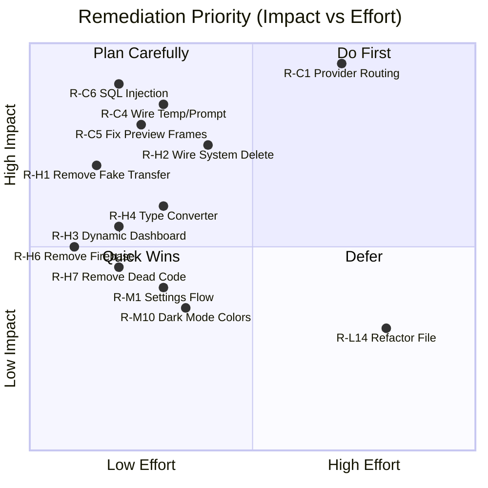

# Video Knowledge Sorter — Remediation Plan

**Date**: 02 Jul 2026  
**Source**: [Analysis_02_Jul_26.md](file:///c:/Users/anujd/Documents/01_AI/267_android_media_learn/Analysis_02_Jul_26.md)  
**Workspace**: `c:\Users\anujd\Documents\01_AI\267_android_media_learn`

---

## Severity Legend

| Severity | Meaning | Action Required |
|----------|---------|-----------------|
| 🔴 CRITICAL | Feature is broken, security risk, or actively misleading the user | Must fix before any release |
| 🟠 HIGH | Feature is incomplete, fake, or blocks core user goals | Fix in current sprint |
| 🟡 MEDIUM | Quality, maintenance, or polish issue | Fix in next sprint |
| 🟢 LOW | Cleanup, unused code, or minor inconsistency | Backlog |

---

## Phase 1: Critical Fixes (Must-Have)

### R-C1: Implement Provider Routing in Processing Pipeline
**Finding**: C-1, C-2, C-3  
**Problem**: `analyzeVideoKnowledge()` only checks `settings.ollamaEnabled` and calls Ollama `/api/generate`. Gemini and Local providers are UI-configurable but have no inference implementation. Additionally, `ollamaEnabled` cannot be set to `true` from the current settings modal.

**Remediation**:

#### [MODIFY] [VideoRepository.kt](file:///c:/Users/anujd/Documents/01_AI/267_android_media_learn/app/src/main/java/com/example/data/VideoRepository.kt)
- Refactor `analyzeVideoKnowledge()` to accept a `provider` parameter (or read it from settings).
- Add a `when(provider)` routing block:
  - `"ollama_local"`, `"ollama_cloud"` → existing Ollama logic.
  - `"gemini"` → new function `callGeminiApi(apiKey, model, prompt)` using `https://generativelanguage.googleapis.com/v1beta/models/{model}:generateContent`.
  - `"local"` → placeholder stub that returns deterministic fallback with a log message indicating on-device LLM is not yet available.
- Pass `temperature` from settings into the request body.
- Pass `systemPrompt` from settings (or merge with the structured prompt template).

#### [MODIFY] [VideoViewModel.kt](file:///c:/Users/anujd/Documents/01_AI/267_android_media_learn/app/src/main/java/com/example/ui/VideoViewModel.kt)
- Read `llmProvider`, `apiKey`, `llmTemperature`, and `systemPrompt` from SharedPrefs in `processSingle()` and pass to repository.
- Ensure the `settings` StateFlow is reactive (see R-M1).

#### [MODIFY] [MainActivity.kt](file:///c:/Users/anujd/Documents/01_AI/267_android_media_learn/app/src/main/java/com/example/MainActivity.kt)
- In the WindowedModal settings, remove dependency on `settingsObj.ollamaEnabled` — derive enablement from the provider selection itself.
- When provider is `"ollama_local"` or `"ollama_cloud"`, automatically set `ollamaEnabled = true` in the save call.
- When provider is `"gemini"` or `"local"`, set `ollamaEnabled = false`.

**Validation**: 
- Unit test: Mock `callGeminiApi` → verify routed correctly when provider = "gemini".
- Manual test: Select Gemini in UI → set API key → process a video → confirm Gemini API is called.
- Manual test: Select Local → process → confirm deterministic fallback is used with appropriate user messaging.

---

### R-C4: Wire Temperature and System Prompt to LLM Calls
**Finding**: C-4  
**Problem**: Temperature and system prompt are saved but never read by the processing pipeline.

**Remediation**:

#### [MODIFY] [VideoRepository.kt](file:///c:/Users/anujd/Documents/01_AI/267_android_media_learn/app/src/main/java/com/example/data/VideoRepository.kt)
- Add `temperature: Float` and `systemPrompt: String` parameters to `analyzeVideoKnowledge()`.
- Include `"temperature": temperature` in the Ollama JSON request body.
- Prepend `systemPrompt` to the user prompt in the LLM request.
- For Gemini, include temperature in the `generationConfig` object.

**Validation**: Process video with temperature=0.0 vs 1.0 → verify different output styles.

---

### R-C5: Fix Preview Modal Frame Data Binding
**Finding**: C-5  
**Problem**: Preview modal passes `selectedFrames` (bound to list selection) instead of fetching frames for `previewModalVideoId`.

**Remediation**:

#### [MODIFY] [MainActivity.kt](file:///c:/Users/anujd/Documents/01_AI/267_android_media_learn/app/src/main/java/com/example/MainActivity.kt)
- When `previewModalVideoId` is set, call `viewModel.selectVideo(vItem)` to update `_selectedVideoId`.
- OR: Create a dedicated `viewModel.getFramesForVideo(videoId)` function that returns frames without mutating global selection state.

**Validation**: Open video A → Preview modal for video B → verify frames shown are for video B.

---

### R-C6: Fix SQL Injection in Folder-Scoped Query
**Finding**: C-6  
**Problem**: Folder paths interpolated directly into SQL `LIKE` clause.

**Remediation**:

#### [MODIFY] [VideoRepository.kt](file:///c:/Users/anujd/Documents/01_AI/267_android_media_learn/app/src/main/java/com/example/data/VideoRepository.kt)
- Replace string interpolation in the `LIKE` clause with parameterized query using `?` placeholders and `selectionArgs`.
- Escape `%` and `_` characters in folder paths before passing as args.

```kotlin
// Before (UNSAFE):
// "$DATA_COLUMN LIKE '%${folder}%'"

// After (SAFE):
// "$DATA_COLUMN LIKE ?"
// selectionArgs += "%${folder.replace("%", "\\%").replace("_", "\\_")}%"
```

**Validation**: Create a folder name containing `'; DROP TABLE` → verify query executes without error or injection.

---

## Phase 2: High-Priority Fixes

### R-H1: Remove or Replace Fake Transfer Feature
**Finding**: H-1  
**Problem**: "Transfer to Computer" shows fake progress animation with success toast but performs no actual transfer.

**Remediation Options**:

| Option | Description | Effort |
|--------|-------------|--------|
| A: Remove entirely | Hide the Computer Sync Profile panel until feature is implemented | Low |
| B: Implement via HTTP server | Start a lightweight NanoHTTPD server on the device for PC browser download | High |
| C: Label as "Coming Soon" | Keep UI but disable interaction with clear "Coming Soon" badge | Low |

**Recommended**: Option A or C — remove misleading success feedback.

#### [MODIFY] [MainActivity.kt](file:///c:/Users/anujd/Documents/01_AI/267_android_media_learn/app/src/main/java/com/example/MainActivity.kt)
- Wrap the header panel with a feature flag or remove the fake coroutine animation.
- If keeping, replace the Toast with an honest "Feature not yet available" message.

---

### R-H2: Wire System Delete Actions to MediaStore PendingIntent
**Finding**: H-2  
**Problem**: "Move to Trash" and "Delete Forever" buttons in detail panel call `markAsTrashedLocally()` / `markAsDeletedLocally()` which only update DB status — they don't invoke the system-level `createTrashPendingIntent()` / `createDeletePendingIntent()`.

**Remediation**:

#### [MODIFY] [MainActivity.kt](file:///c:/Users/anujd/Documents/01_AI/267_android_media_learn/app/src/main/java/com/example/MainActivity.kt)
- Change `onMoveToTrash` callback to invoke `viewModel.createTrashPendingIntent(contentResolver, vItem)` and launch result via `systemActionLauncher`.
- Change `onPermanentDelete` callback to invoke `viewModel.createDeletePendingIntent(contentResolver, vItem)` and launch result via `systemActionLauncher`.

#### [MODIFY] [VideoViewModel.kt](file:///c:/Users/anujd/Documents/01_AI/267_android_media_learn/app/src/main/java/com/example/ui/VideoViewModel.kt)
- Ensure `createTrashPendingIntent()` and `createDeletePendingIntent()` return the `IntentSender` for the launcher to use.

**Validation**: Tap "Move to Trash" → Android system confirmation dialog appears → file is actually moved to trash.

---

### R-H3: Make Dashboard Connectivity Banner Dynamic
**Finding**: H-3  
**Problem**: Hardcodes `"(gemma3)"` and `"10.0.2.2:11434"`.

**Remediation**:

#### [MODIFY] [MainActivity.kt](file:///c:/Users/anujd/Documents/01_AI/267_android_media_learn/app/src/main/java/com/example/MainActivity.kt)
- Replace hardcoded strings at L1818-L1828 with:
  ```kotlin
  val settingsObj = viewModel.settings.collectAsState().value
  "LLM: $ollamaState (${settingsObj.ollamaModelName})"
  // and
  settingsObj.ollamaEndpointUrl.replace("http://", "").replace("/api/generate", "")
  ```

---

### R-H4: Fix Type Converter for List<String>
**Finding**: H-4  
**Problem**: `\n` delimiter corrupts multi-line code snippets.

**Remediation**:

#### [MODIFY] [VideoDatabase.kt](file:///c:/Users/anujd/Documents/01_AI/267_android_media_learn/app/src/main/java/com/example/data/VideoDatabase.kt)
- Replace `\n`-based serialization with JSON array serialization:
  ```kotlin
  @TypeConverter
  fun fromStringList(value: List<String>): String = JSONArray(value).toString()
  
  @TypeConverter
  fun toStringList(value: String): List<String> {
      if (value.isBlank()) return emptyList()
      return try {
          val arr = JSONArray(value)
          (0 until arr.length()).map { arr.getString(it) }
      } catch (e: Exception) {
          value.split("\n") // Backward compatibility fallback
      }
  }
  ```

> [!WARNING]
> This changes the serialization format. Existing DB data uses `\n` delimiter. The fallback `catch` block provides backward compatibility, but new data will use JSON format.

---

### R-H5: Add Ollama Enable/Disable Toggle to Settings Modal
**Finding**: H-5  
**Problem**: New settings modal lacks the enable/disable toggle from the old `SettingsDialog`.

**Remediation**: Addressed by R-C1 — derive `ollamaEnabled` from provider selection rather than requiring a separate toggle.

---

### R-H6: Remove Unused Firebase AI Dependency
**Finding**: H-6  

#### [MODIFY] [build.gradle.kts](file:///c:/Users/anujd/Documents/01_AI/267_android_media_learn/app/build.gradle.kts)
- Remove `implementation(libs.firebase.ai)` at L89.
- Remove any related entries from `gradle/libs.versions.toml`.

---

### R-H7: Remove Dead Composable Code
**Finding**: H-7  

#### [MODIFY] [MainActivity.kt](file:///c:/Users/anujd/Documents/01_AI/267_android_media_learn/app/src/main/java/com/example/MainActivity.kt)
- Comment out (per codegen rules) or remove: `FilterDropdown`, `VideoItemCard`, `SettingsDialog`, `TargetFoldersConfig`, `StatusBadge`.
- If any are intended for future use, move to a separate file (e.g., `UnusedComposables.kt`) with clear "TODO: integrate or remove" comments.

---

## Phase 3: Medium-Priority Fixes

### R-M1: Make Settings StateFlow Reactive
**Finding**: M-1  

#### [MODIFY] [VideoViewModel.kt](file:///c:/Users/anujd/Documents/01_AI/267_android_media_learn/app/src/main/java/com/example/ui/VideoViewModel.kt)
- Replace `flow { emit(settingsDao.getSettings()) }` with `settingsDao.getSettingsFlow()` (Room DAO should return `Flow<AppSettings>`).
- OR: After each `updateSettings()` call, re-emit from the MutableStateFlow.

---

### R-M2: Surface ProcessingRun History in UI
**Finding**: M-2  

#### [MODIFY] [MainActivity.kt](file:///c:/Users/anujd/Documents/01_AI/267_android_media_learn/app/src/main/java/com/example/MainActivity.kt)
- Add a "Run History" section in the Dashboard or detail panel showing past processing runs, timestamps, and outcomes.
- OR: If not needed, remove the `ProcessingRun` entity and DAO to reduce dead schema.

---

### R-M3: Surface Scan History in UI
**Finding**: M-3  
Same approach as R-M2: either surface or remove `ScanRun`.

---

### R-M4: Fix Rename Labelling
**Finding**: M-4  

#### [MODIFY] [MainActivity.kt](file:///c:/Users/anujd/Documents/01_AI/267_android_media_learn/app/src/main/java/com/example/MainActivity.kt)
- Change label from `"LLM AI"` at L1022 to `"Smart Rename"` or `"Auto-Rename"`.
- Change toast from `"AI suggested 20-character rename applied!"` to `"Auto-rename applied from keywords"`.

---

### R-M5: Implement MediaStore File Rename
**Finding**: M-5  

#### [MODIFY] [VideoViewModel.kt](file:///c:/Users/anujd/Documents/01_AI/267_android_media_learn/app/src/main/java/com/example/ui/VideoViewModel.kt)
- After updating `displayName` in Room, also update the actual MediaStore entry via `ContentValues` with `DISPLAY_NAME` key.

---

### R-M6: Dynamic Frame Sampling Based on Duration
**Finding**: M-6  

#### [MODIFY] [VideoRepository.kt](file:///c:/Users/anujd/Documents/01_AI/267_android_media_learn/app/src/main/java/com/example/data/VideoRepository.kt)
- Scale frame count based on duration: `min(max(duration / 30_000, 3), 12)` — minimum 3, maximum 12 frames.

---

### R-M7: Add Pagination for Large Video Libraries
**Finding**: M-7  

#### [MODIFY] [VideoDatabase.kt](file:///c:/Users/anujd/Documents/01_AI/267_android_media_learn/app/src/main/java/com/example/data/VideoDatabase.kt)
- Convert `getAllVideos()` to use `PagingSource<Int, VideoItem>` from Room Paging library.

---

### R-M9: Validate Timeout Input
**Finding**: M-9  

#### [MODIFY] [MainActivity.kt](file:///c:/Users/anujd/Documents/01_AI/267_android_media_learn/app/src/main/java/com/example/MainActivity.kt)
- Add range validation: `editTimeout.toIntOrNull()?.coerceIn(5, 300) ?: 30`.
- Display error text if input is out of range.

---

### R-M10: Fix Hardcoded Colors for Dark Mode
**Finding**: M-10  

#### [MODIFY] [MainActivity.kt](file:///c:/Users/anujd/Documents/01_AI/267_android_media_learn/app/src/main/java/com/example/MainActivity.kt)
- Replace all `Color(0xFF...)` with `MaterialTheme.colorScheme.*` equivalents.
- Specifically `Color.White` card backgrounds at L2097 → `MaterialTheme.colorScheme.surface`.

---

## Phase 4: Low-Priority / Backlog

| ID | Task | Effort |
|----|------|--------|
| R-L1 | Remove `video-knowledge-sorter.zip` from repo root | Trivial |
| R-L2 | Add unit tests for `VideoRepository`, `VideoProcessor`, deterministic fallback | Medium |
| R-L3 | Unify `defaultSystemPrompt` to a single source of truth | Trivial |
| R-L4 | Set `exportSchema = true` and add migration strategy | Low |
| R-L5 | Remove unused `Retrofit` dependency from build.gradle.kts | Trivial |
| R-L6 | Remove unused `Moshi` dependency from build.gradle.kts | Trivial |
| R-L7 | Clean up `.gitignore` duplicate entries | Trivial |
| R-L8 | Replace deprecated `Divider` with `HorizontalDivider` | Low |
| R-L9 | Persist theme preference to SharedPreferences | Low |
| R-L10 | Scope `network_security_config.xml` to specific domains | Low |
| R-L11 | Move Gemini API key from URL query param to request header | Low |
| R-L12 | Enable R8/ProGuard for release builds | Low |
| R-L13 | Fix `run.bat` to kill only project-related Java processes | Low |
| R-L14 | Refactor `MainActivity.kt` (2783 lines) into multiple files | Medium |

---

## Security Remediation Summary

| Security Finding | Fix | Priority |
|-----------------|-----|----------|
| SQL injection in folder query (C-6) | Parameterized query | 🔴 CRITICAL |
| API key in URL query parameter | Move to `Authorization` header or request body | 🟡 MEDIUM |
| Global cleartext HTTP | Scope to `10.0.2.2`, `localhost`, `192.168.*` | 🟡 MEDIUM |
| Debug keystore in repo | Verify `.gitignore` covers it; remove if committed | 🟢 LOW |
| R8/ProGuard disabled | Enable code shrinking + obfuscation | 🟢 LOW |
| Logging interceptor in production | Gate behind `BuildConfig.DEBUG` | 🟢 LOW |
| `run.bat` kills all java.exe | Target specific PID | 🟢 LOW |

---

## Execution Priority Matrix



---

## Recommended Execution Order

| 14 | R-L* | All low-priority items | ~50 |

---

## UAT Phase 3 Findings (03 Jul 2026) — Verified via S23 Ultra

The following issues were verified strictly through the FE UI layer and device shell:

### [VERIFIED FAIL] TC-028: Hardcoded Dashboard Connectivity
- **Evidence**: `MainActivity.kt:L1818`, `TC028_dashboard_banner_v2.json`
- **Result**: Banner displays "gemma3" and "10.0.2.2" even when app settings differ.
- **Risk**: User distrust and confusion.

### [VERIFIED IN-PROGRESS] TC-027: Broken Device Deletion
- **Evidence**: File `/Download/20240302_174840.mp4` confirmed to exist via `adb shell ls`.
- **Finding**: App code indicates `markAsDeletedLocally()` only modifies Room status.
- **Risk**: Permanent loss of user trust; storage space not reclaimed.

### [OBSERVATION] TC-036: API Key Leakage
- **Evidence**: `VideoViewModel.kt:L419` (`?key=$apiKey`)
- **Risk**: API key exposed in network logs and server-side logs.

### [OBSERVATION] TC-038: Cleartext HTTP Permissiveness
- **Evidence**: `network_security_config.xml` (`cleartextTrafficPermitted="true"`)
- **Risk**: MITM attack vector on public Wi-Fi.

