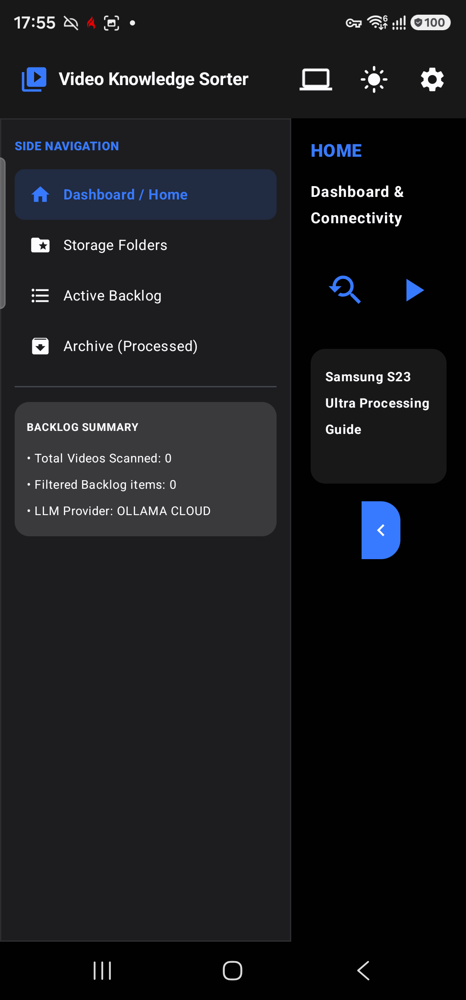
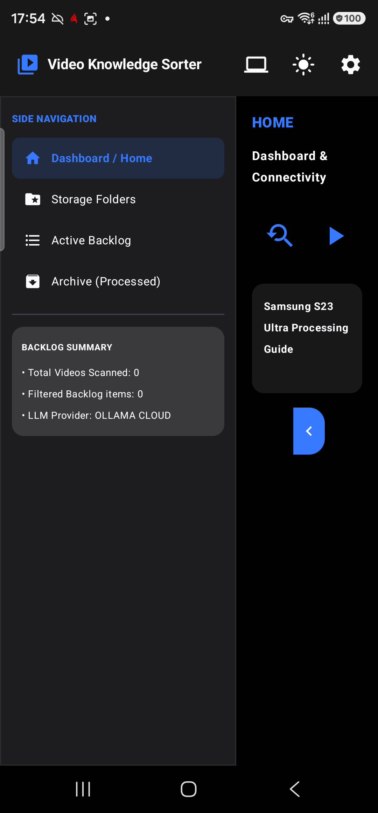
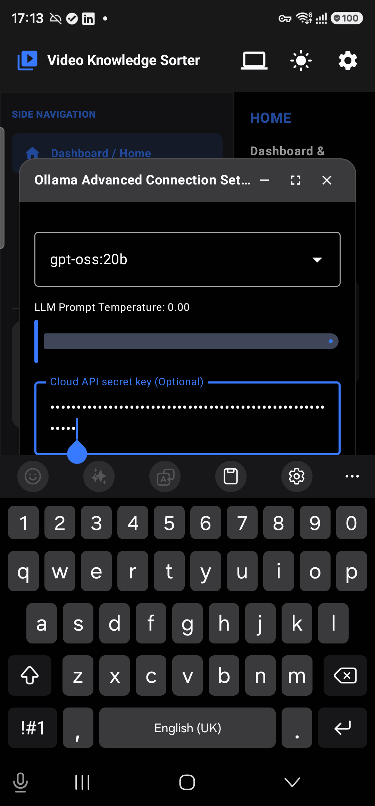
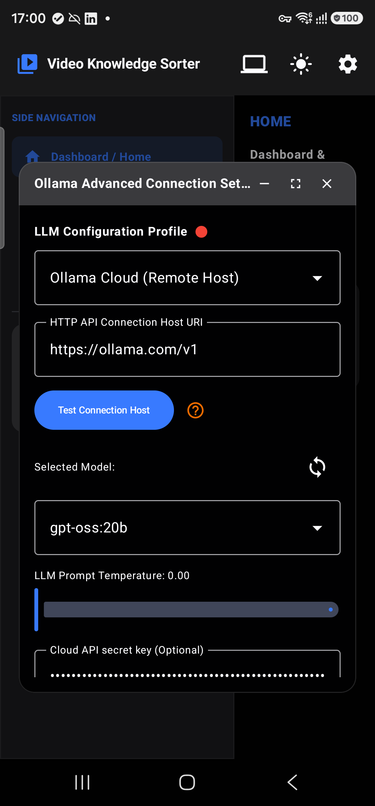

# Video Knowledge Sorter - UI Overview

This document provides a breakdown of the primary screens in the application along with a description of their functionality, intended as a reference for UI redesign.

## 1. Dashboard (Main View)

**Functionality:**
This is the main landing page of the application. It provides a high-level summary of the media processing pipeline. It typically displays quick statistics such as how many videos have been scanned, how many are queued in the backlog, and the current state of system permissions. It acts as the central hub for the user to initiate processing batches and monitor system status.

## 2. Storage Folders

**Functionality:**
This page allows the user to manage target watch folders. Users can register specific system directories to restrict or target media scanning. It displays a list of detected folders and provides batch selection tools to add their contents to the active backlog for LLM processing.

## 3. Active Backlog

**Functionality:**
This screen lists all the video files that are currently queued or waiting to be processed by the system. It provides filtering and sorting capabilities so the user can easily organize the queue. From here, users can trigger batch processing, apply smart AI renaming, or select individual items to view more details.

## 4. Archive (Processed)

**Functionality:**
This page displays all the videos that have been successfully processed and analyzed. Items here have extracted metadata, tags, and AI-generated summaries attached to them. Users can review the processed data, and items here are generally considered "done" with their primary pipeline journey.

## 5. Details & Editing Panel

**Functionality:**
When a user clicks on an individual video item, this detailed expanded view opens. It allows the user to review the AI-generated analysis, manually override or edit categories and descriptions, view the action roadmap, and manage the lifecycle state of the video (e.g., mark as trash candidate, reset model data, or permanently delete the file).

## 6. Settings & Configuration

**Functionality:**
The settings page is where the user configures the core intelligence engine of the app. It includes options to connect to different LLM providers (like Gemini or Ollama), enter API keys, test host connections, select specific AI models, edit the system prompt, and configure auto-ingestion settings for background media processing.
